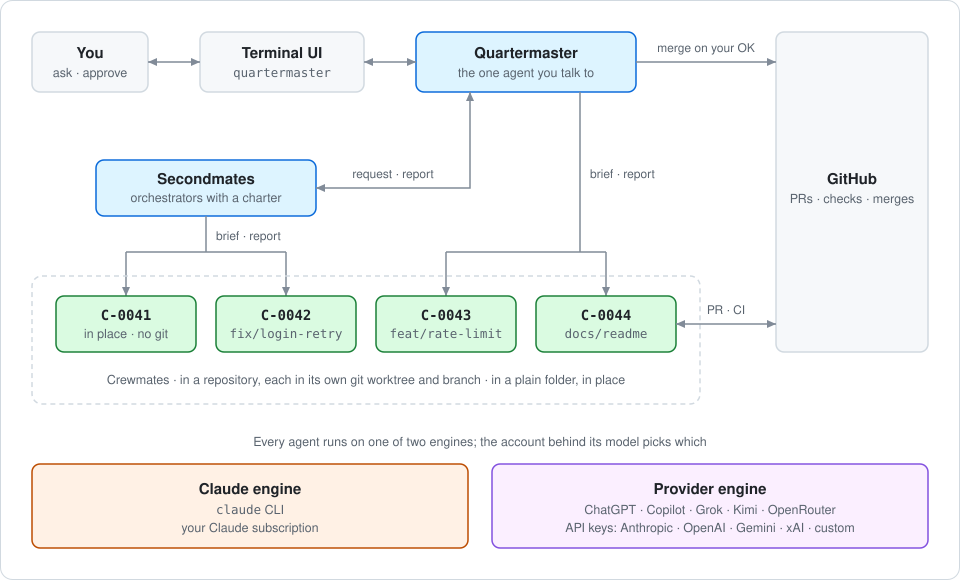
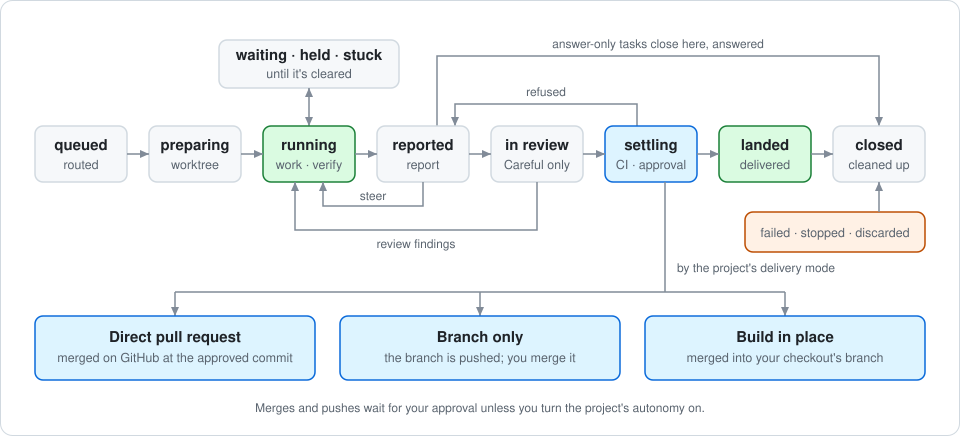
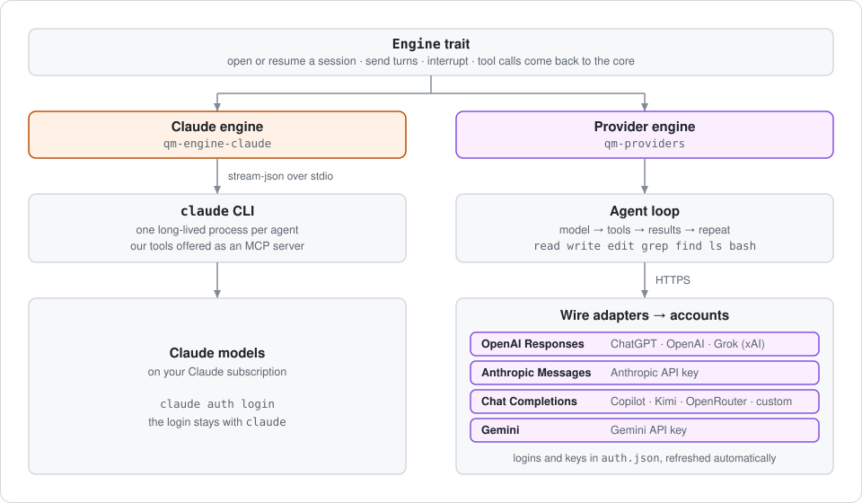
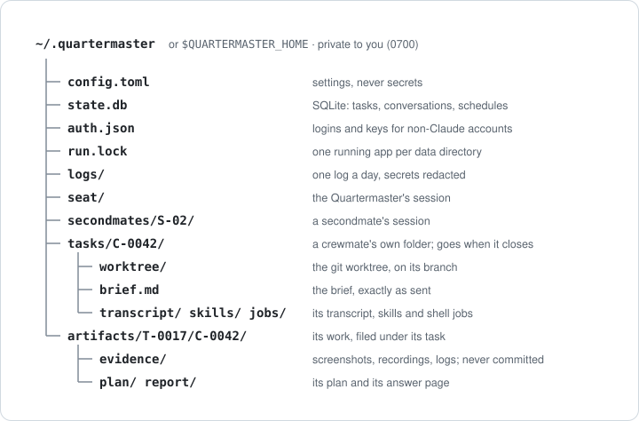
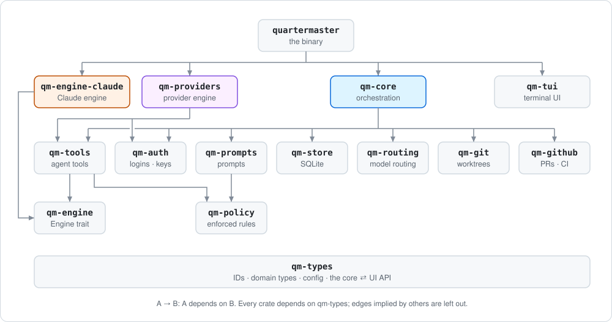

# Quartermaster

```sh
curl -fsSL https://github.com/Adham-Aly/quartermaster/releases/latest/download/quartermaster-installer.sh | sh
```

> [!IMPORTANT]
> **This one command is how you install Quartermaster** (Apple silicon or Intel). Paste it into
> Terminal, then run `quartermaster`. It tells you when a new version is out (**☰ Menu ▸ Update**
> installs it), or run the command again to update. Don't download the files on the Releases
> page: in a browser they install nothing.

A macOS terminal app where you talk to one agent, the Quartermaster. It hands project work to
crewmates (C-0042), grouped into short-lived tasks (T-0017), and brings the results back for you to
approve. A project is any folder they work in, listed while they do: a GitHub repository gets
worktrees and pull requests, a local repository worktrees merged once you approve, and a plain
folder is edited in place, with no git unless you ask.



## A task's life

[Model routing](docs/routing.md): task kinds, model levels, effort, quota and your choices.



The Quartermaster and secondmates can link their own tasks with `link_tasks` when one must land
before another. If a dependency is no longer needed—for example, a stopped task's work landed
through another pull request—they can remove that directed link with `unlink_tasks` and retry
`settle_task`. Stopping or closing a blocker does not silently waive the dependency; a refused
settlement names the link and how to remove it. Other blockers remain in force.

## Engines and accounts



## Install

Use the command at the top of this page. It picks the build for your Mac, checks its checksum,
installs `quartermaster` into `~/.cargo/bin` (or `$QUARTERMASTER_INSTALL_DIR`) and adds that folder
to your `PATH`.

**From source:** install [rustup](https://rustup.rs) (it installs the Rust release pinned in
`rust-toolchain.toml` by itself; Homebrew's `rust` ignores that file), then:

```sh
git clone https://github.com/Adham-Aly/quartermaster.git
cd quartermaster
cargo xtask install
```

## Requirements

| Needs | Notes |
|---|---|
| macOS 13 or later | Apple silicon or Intel |
| Command Line Tools | `xcode-select --install` (provides `git`) |
| Your git identity | `git config --global user.name` / `user.email`: commits are made as you |
| Claude Code, logged in | `claude auth login` with a Claude subscription; version 2.1.303 or later, below 3.0 |
| GitHub CLI, logged in | `gh auth login`: pull requests, pushes and CI (without it, projects build in place) |
| A terminal | at least 60×16 |
| Optional | other providers' accounts, added in **Settings ▸ Accounts** |

Never set `ANTHROPIC_API_KEY` or `CLAUDE_CONFIG_DIR`: they bypass the `claude` login the app uses.

## Run

```sh
quartermaster
```

When `git`, the GitHub CLI or Claude Code is missing or logged out, a red dot shows on the menu;
**Settings ▸ System** says what's wrong, and its **Setup check** installs or logs in. Press `?`
for keys.



`quartermaster` attaches this window to a background server, starting it if none is running.
Closing the window (or `Ctrl`+`C` twice on an empty field) only detaches: the server and your
agents keep running, and any number of windows can attach. `quartermaster server status`,
`server stop` (asks first when agents are working; `--force` skips the question) and
`server restart` manage it. After an
update, restart the server to run the new version: a newer window attached to an older server
says so and offers a Restart button, and windows re-attach by themselves. `quartermaster --foreground` runs server and window in one process.
One server runs per data directory. For a throwaway one:
`QUARTERMASTER_HOME=$(mktemp -d) quartermaster --foreground`.

**Settings ▸ Routing ▸ Autocompact** sets the conversation size at which every agent compacts (100k–1M, default 200k), on Claude and other models alike. For Quartermaster's Claude agents it replaces Claude Code's `/autocompact`; your own `claude` is unchanged.

## Code



| Task | Command |
|---|---|
| Build | `cargo xtask build` |
| Format and lint | `cargo xtask check` |
| Install this checkout | `cargo xtask install` |
